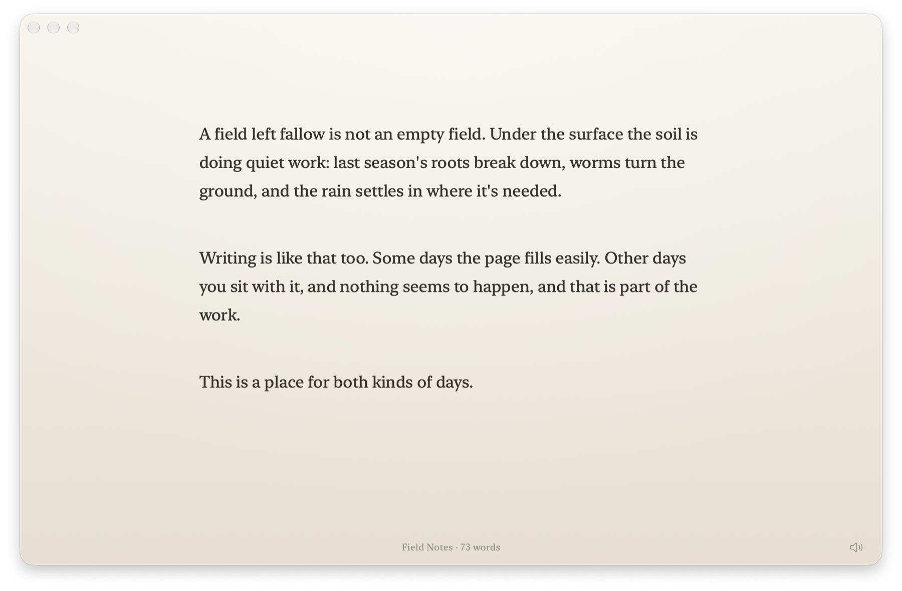
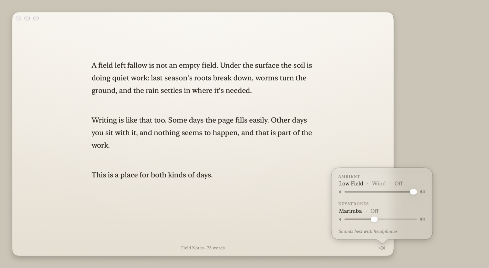

# Fallow

A quiet place to write. Fallow is a native macOS app for distraction-free writing: just your words in a centered column on a soft background. The window's controls fade away while you type and come back when you move the mouse.

<picture>
  <source media="(prefers-color-scheme: dark)" srcset="docs/images/writing-dark.png">
  
</picture>

It's named after fallow ground, a field left to rest before it's planted again.

## Install
With [Homebrew](https://brew.sh):

```sh
brew install --cask ryanromanov/tap/fallow-writer
```

Or download the latest `Fallow-x.y.z.zip` from [Releases](https://github.com/ryanromanov/fallow-writer/releases), unzip it, and move **Fallow** to Applications. Each release is signed and notarized by Apple. Fallow runs on macOS 13 or later, on Apple Silicon and Intel Macs.

## Features
- Plain text and Markdown files (`.txt`, `.md`), with autosave and version history
- A centered writing column with typewriter scrolling, so the line you're typing stays in the middle of the window
- Serif, sans serif or monospaced type (the system's own fonts), adjustable size and line spacing
- Light and dark appearance, and native full screen (⌃⌘F)
- A live word count
- Letters settle softly into place as you type (View › Animate Typing; off when Reduce Motion is on)
- Ambient sound, all generated live with nothing recorded: **Low Field**, a warm, slowly shifting drone, or **Wind**, gusts moving across an open field
- **Marimba** keystroke sounds: soft wooden notes on a pentatonic scale, so typing makes gentle music. Space, return and delete each have their own sound
- A speaker button in the corner opens a small panel for choosing sounds and setting their volumes. Fallow remembers your choices
- Sandboxed: Fallow can only open the files you choose



Coming later: more sounds and backgrounds, and export.

## Building
Fallow is a Swift package and needs no Xcode project. With the Command Line Tools installed (Swift 6 or later), on macOS 13 or later:

```sh
scripts/bundle.sh    # builds Fallow.app
open Fallow.app
scripts/test.sh      # runs the tests
scripts/audition.sh  # renders preview WAVs of the sounds into ./audition
scripts/screenshots.sh  # renders the README's screenshots into docs/images
```

## License
MIT. See [LICENSE](LICENSE). Fallow is not affiliated with OmmWriter.
